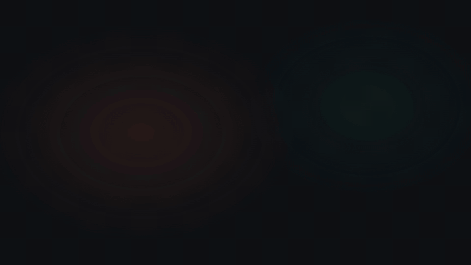
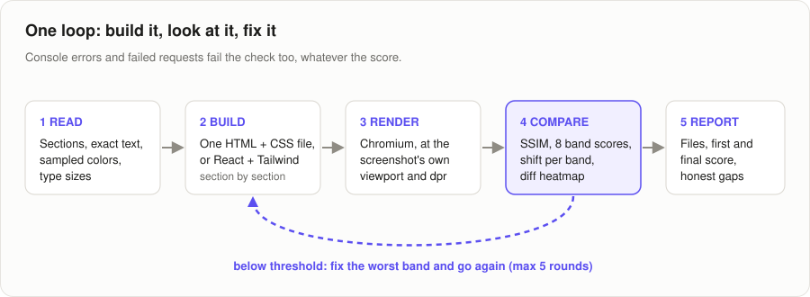
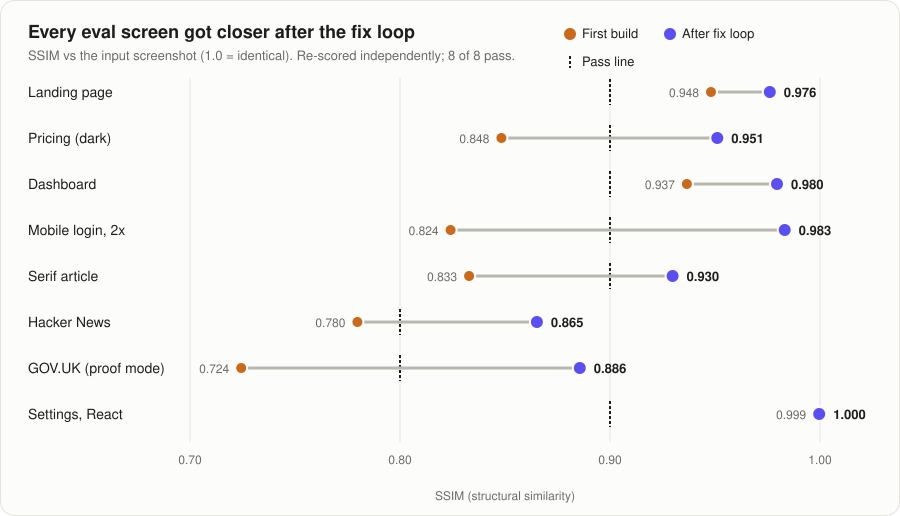
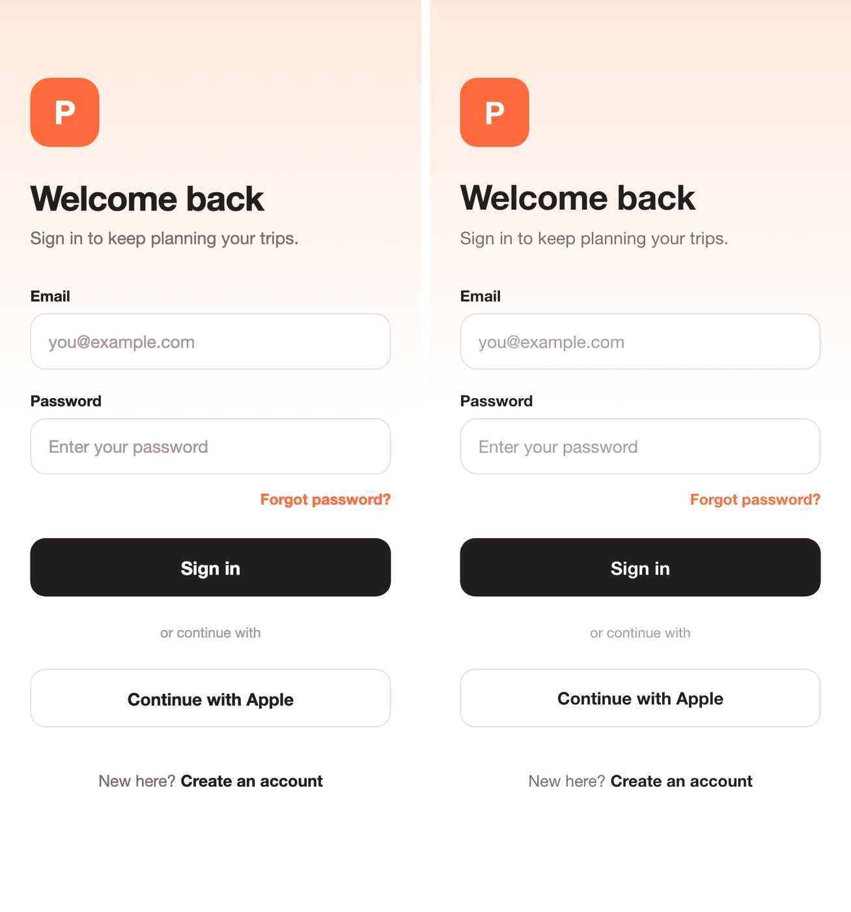
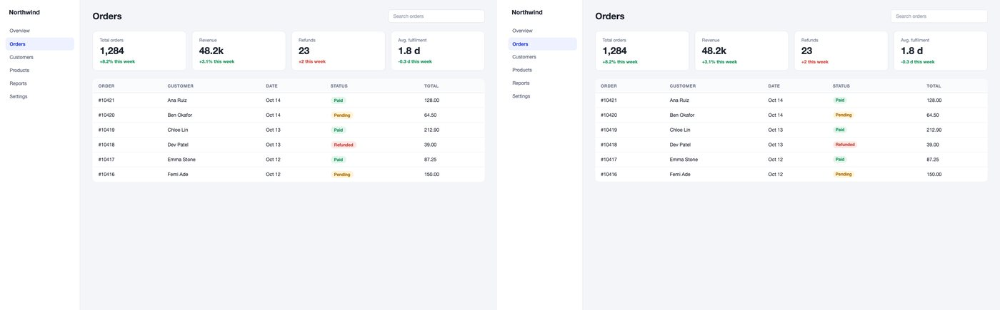
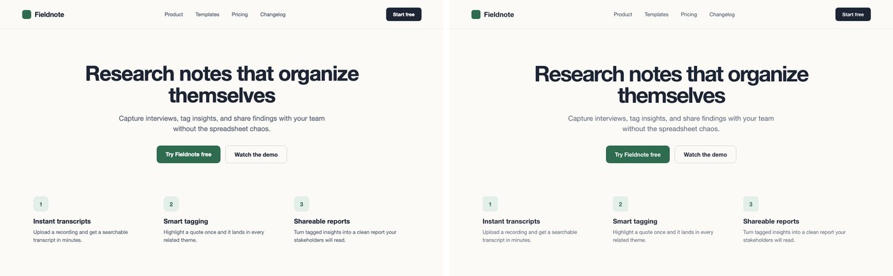
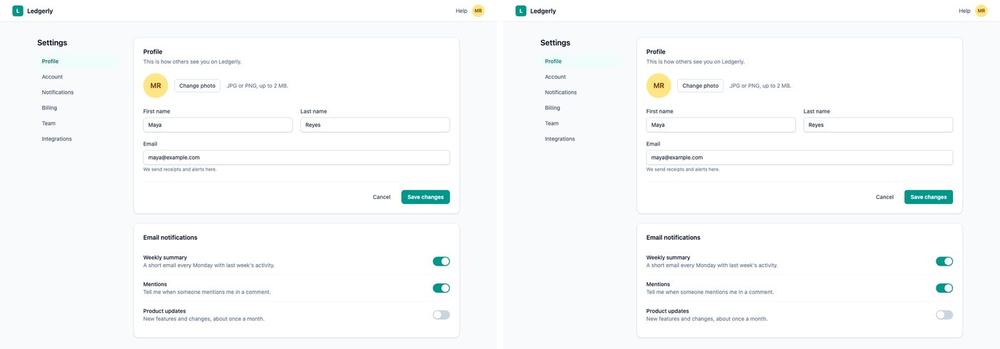
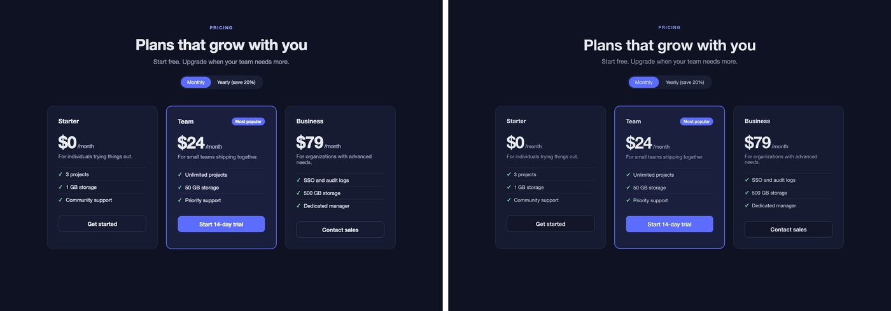
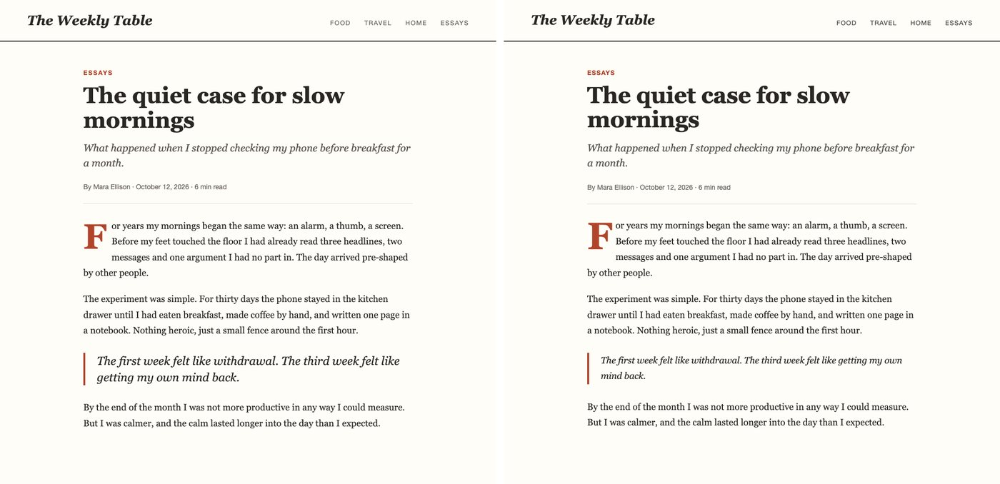

<p align="center">
  
</p>

<p align="center">
  <a href="LICENSE"></a>
  <a href="evals/RESULTS.md"></a>
  <a href="https://github.com/deserteaglemj/shotproof/actions/workflows/tests.yml"></a>
  
</p>

Drop in a screenshot of any website or app screen. Your agent rebuilds it as one clean HTML + CSS file (or React + Tailwind), opens the result in Chromium at the screenshot's exact size, scores it against your image, and fixes the worst-matching part. It repeats until the score passes, then tells you the number and what it could not match.

It runs on the model you already use in Claude Code or Codex. There is nothing else to sign up for and no API key to paste.

<p align="center">
  
  <br><sub><a href="assets/demo.mp4">Watch the full-quality video with sound (MP4)</a></sub>
</p>

## Install in 30 seconds

**Claude Code**

```text
/plugin marketplace add deserteaglemj/shotproof
/plugin install shotproof@shotproof
```

**Codex**

```bash
codex plugin marketplace add deserteaglemj/shotproof
codex plugin add shotproof@shotproof
```

**One-time helper setup** (the checker uses Playwright, Pillow and numpy; skip if you have them):

```bash
python3 -m pip install playwright pillow numpy && python3 -m playwright install chromium
```

Then:

```text
/shotproof ./landing.png
/shotproof ./app.png react
/shotproof ./prospect.png proof example-client
```

Or just say "turn this screenshot into code". Codex picks the skill up the same way.

## What a run looks like

```text
  ┌─────────────┐     ┌──────────────┐     ┌───────────────┐
  │  shot.png   │ ──▶ │  index.html  │ ──▶ │  render.png   │ ──▶  score, fix, repeat
  └─────────────┘     └──────────────┘     └───────────────┘

  $ /shotproof login.png          390 x 844 CSS px, dpr 2 (detected)

  round 1   ████████████████░░░░   0.824   worst: band 5/8 (y 844-1055px)
  round 2   █████████████████░░░   0.849   worst: band 5/8 (y 844-1055px)
  round 3   ████████████████████   0.979   PASS
  round 4   ████████████████████   0.983   PASS

  wrote   login/index.html
  gaps    font is a system stack (real font unknown); hover and focus states inferred
```

Those are the real scores from the mobile-login eval case. The bar is SSIM, a standard 0-to-1 measure of how alike two images look.

## How it works

<p align="center"></p>

1. **Read like a builder.** Sections with pixel ranges, every word copied exactly, colors sampled from real pixels (not guessed), type sizes measured from glyph heights, spacing grid, components, images.
2. **Build section by section.** Semantic HTML, CSS variables for the sampled palette, flexbox and grid, real text, visible focus states, a sensible phone layout.
3. **Render and compare.** `s2c.py verify` screenshots the page with Chromium and writes a side-by-side image, a red diff heatmap, the overall score, a score for each of 8 horizontal bands, and how many pixels each band is shifted up or down.
4. **Fix the worst band first** with targeted edits (never a full rewrite), re-check, keep the best round, and stop at the pass line or after 5 rounds. Console errors, failed requests, a blank page, one image covering over a quarter of the page (a pasted screenshot) or sideways scroll at 375px wide fail the check no matter how good the score looks.
5. **Report honestly**: files written, first and final score, and the gaps it could not close.

## The proof

<p align="center"></p>

Eight test screens. Six are pages written for the test (so the true answer is known; one of them is a React + Tailwind app) and two are real public sites captured read-only. Each was rebuilt by a fresh agent that saw only the screenshot and the skill, and every final page was then re-scored by a separate script. All 8 pass; the fix loop added 0.085 SSIM on average (0.097 across the seven HTML cases). The React case scored 0.9996, which mostly shows its source used Tailwind's defaults too. Full numbers, per-round logs and limits: [evals/RESULTS.md](evals/RESULTS.md).

**Left: the input screenshot. Right: what the agent built.**

<p align="center"></p>
<p align="center"></p>
<p align="center"></p>

<details>
<summary>Three more cases</summary>

<p align="center"></p>
<p align="center"></p>
<p align="center"></p>

</details>

The two real-site cases (Hacker News, and GOV.UK rebuilt in private proof mode) passed too; their images stay out of this repo because they show third-party logos and real users' posts.

## Three modes

| Mode | When | Output |
| --- | --- | --- |
| **HTML** (default) | Anything | One `index.html` with inline CSS. No build step, no CDN, no web fonts, so it renders the same everywhere. |
| **React + Tailwind** | You ask, or the project already uses React | Components written into your project, following its existing conventions, checked against your local dev server. |
| **Private client proof** | Redesign pitches and agency outreach | A locked-down concept page: `noindex,nofollow`, a visible "private concept" banner, no scripts, iframes, forms or remote URLs, no price claims, checked offline and previewed on 127.0.0.1 only. `s2c.py proof-check` enforces all of it. |

## How it compares

| | shotproof (this plugin) | [abi/screenshot-to-code](https://github.com/abi/screenshot-to-code) | Asking your agent with no plugin |
| --- | --- | --- | --- |
| Where it runs | Inside Claude Code or Codex | Its own web app (React + FastAPI) | Inside your agent |
| Model and keys | Your agent's own model, no extra key | Bring an OpenAI, Anthropic or Gemini API key | Your agent's own model |
| Checks its own output | Renders at the screenshot's own size and dpr, scores it (SSIM overall and per band), and fixes the worst band for up to 5 rounds against a fixed pass line | Renders desktop (1280x832) and mobile (342x684) previews for the model to look at; no score, diff or pass line | Only if you ask, and with no score |
| Fails the check on | Low score, console or request errors, a blank page, a pasted screenshot, sideways scroll at 375px | Nothing automatic | Nothing |
| Output | HTML + CSS with no CDN or web fonts, or React + Tailwind in your repo | Six stacks (Tailwind, Bootstrap, Vue, Ionic and more), video input, AI image generation | Whatever it decides |
| Published evals | 8 cases (7 HTML, 1 React), scored by script, results in the repo | Hand-rated eval set and pairwise voting; set and results not published | None |

abi/screenshot-to-code is a great standalone app: more stacks, video input, real asset extraction and image generation, and a full web UI with variants and select-and-edit. shotproof is for people who already work in an agent and want the result rendered, measured and fixed without leaving it, with no key and no extra cost.

## The helper script

`s2c.py` (inside the skill) works on its own too:

| Command | Does |
| --- | --- |
| `verify REF.png PAGE --out-dir DIR [--dpr 2] [--offline] [--threshold 0.9]` | Render PAGE at REF's size and at 375px, score it, write visuals and a snapshot of the page. Exits 0 only on a pass with no errors. |
| `render PAGE --out x.png --width W --height H [--dpr 2]` | Screenshot a local file or localhost URL |
| `palette REF.png [--at x,y ...]` | Dominant colors, plus exact pixel samples |
| `crop REF.png --box x,y,w,h --out assets/logo.png` | Cut a logo or photo out of the screenshot |
| `proof-check page.html` | Check the private client-proof rules |

Tests: `python3 -m unittest discover -s plugins/shotproof/tests` (scoring, shift detection, palette, every proof rule, the blank, pasted-screenshot and 375px checks, and a real end-to-end render).

## Limitations

- **The score is grayscale SSIM.** It measures how alike the render and the screenshot look, not code quality or accessibility.
- **Static frame only.** Hover, focus, menus and motion are not in a screenshot, so the agent infers them.
- **No font identification or asset extraction.** It picks a system font of the same style and crops images out of the screenshot. The serif article case hit the 5-round cap for that reason.
- **React + Tailwind has one eval case, and an easy one.** Its source also used Tailwind defaults; a design built outside them is untested.
- **Small eval set:** 8 screens. No hosted UI and no video input.
- **Needs Python 3 with Playwright, Pillow and numpy, plus Chromium, on your machine** (one-time setup above).

## FAQ

**Does it send my screenshot anywhere?** Only to the model your agent already uses. The checker runs locally in headless Chromium. Proof mode verifies with the network blocked.

**What score counts as a pass?** 0.90 SSIM for clean UI screenshots and 0.80 for real sites, where custom fonts, photos and icon art cannot be copied exactly. Both were set before the evals ran. You can change it with `--threshold`.

**Will it match pixel for pixel?** No, and it will not claim to. Fonts are the usual gap: it picks a system font of the same style and tells you which real font it thinks the design uses.

**Retina screenshots?** Detected. A 2x Mac screenshot is rendered at half its pixel size with device scale 2.

**Can it do a whole page from several screenshots?** Yes: the same page at different widths becomes one responsive page; different pages share one set of CSS tokens.

## Credits

The quality rules were inspired by a shared `image-to-code` agent skill, and the prompt and evaluation ideas by [abi/screenshot-to-code](https://github.com/abi/screenshot-to-code) (MIT). No text or code was copied from either. The two public-site cases were captured read-only; only their scores are published here.

Made by Marquis Jackson. MIT licensed.
